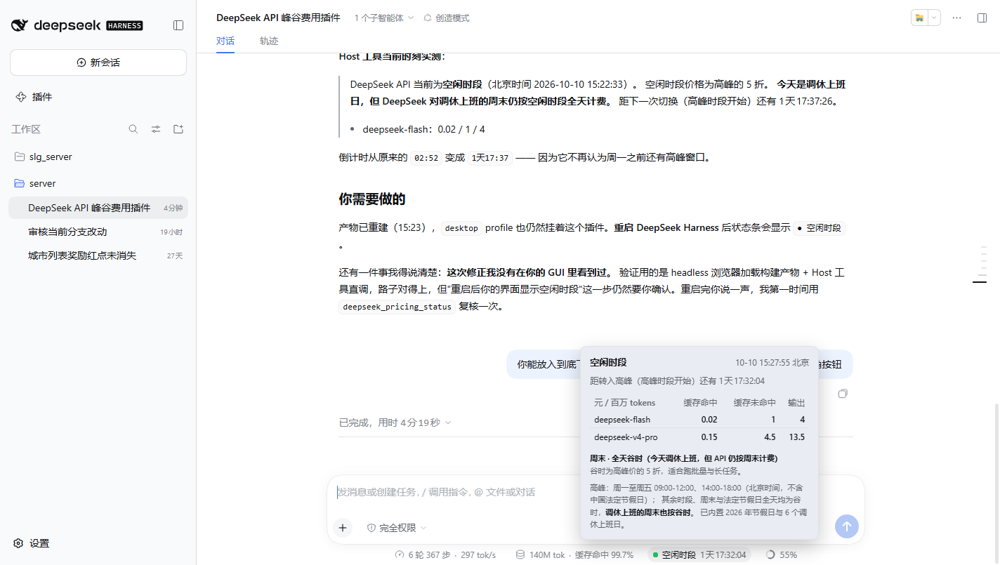

# dsh-deepseek-peak-pricing

DeepSeek Harness 插件：一眼看出当前的 API 请求走的是**高峰**还是**空闲（谷时）**计价。

- **状态条**：作为**输入框底下那一行的第三个读数**，紧挨 ui-chat 的 `297 tok/s` 和 `139M tok·缓存命中 99.7%`，点击展开完整价目表。
- **`deepseek_pricing_status` 工具**：让模型也能知道此刻的单价与倒计时，用于判断要不要把批量请求推到谷时。

规则来源有两处，缺一不可：

1. [DeepSeek API 模型 & 价格](https://api-docs.deepseek.com/zh-cn/quick_start/pricing/) —— 北京时间周一至周五（不含中国法定节假日）09:00-12:00、14:00-18:00 为高峰；其余时段，包括周末及中国法定节假日全天均为空闲。空闲时段价格为高峰的 **5 折**。
2. DeepSeek《API 峰谷时间说明》（2026-09-19）—— **调休上班的周末、中国法定节假日全天均按空闲时段计费**（[IT之家报道](https://tech.ifeng.com/c/8wYE8addLCR)）。价目页没写这一条，但它决定了一个反直觉的结果，见下文。

## 状态条长什么样

它在**输入框底下那一行**，跟 ui-chat 的用时/用量读数并排。这是 **2026-10-10 周六调休日** 的实际读数：


```
6 轮 367 步 · 297 tok/s   140M tok · 缓存命中 99.7%   ● 空闲时段 1天17:32:04   55%
└──── ui-chat 自带 ────┘  └──── ui-chat 自带 ────┘  └─ 本插件 ─┘          └ 上下文 ┘
```

点击后在其上方展开：



```
┌──────────────────────────────────────────────────┐
│ 空闲时段                    10-10 15:27:55 北京   │
│ 距转入高峰（高峰时段开始）还有 1天17:32:04         │
│                                                  │
│ 元 / 百万 tokens   缓存命中  缓存未命中   输出     │
│ deepseek-flash         0.02        1         4   │
│ deepseek-v4-pro        0.15      4.5      13.5   │
│                                                  │
│ 周末 · 全天谷时（今天调休上班，但 API 仍按周末计费）│
│ 谷时为高峰价的 5 折，适合跑批量与长任务。          │
│ 高峰：周一至周五 09:00-12:00、14:00-18:00（北京   │
│ 时间，不含中国法定节假日）；其余时段、周末与法定   │
│ 节假日全天均为谷时，调休上班的周末也按谷时。       │
│ 已内置 2026 年节假日与 6 个调休上班日。            │
└──────────────────────────────────────────────────┘
```

### 为什么挂在这个 slot

`conversation.composer.dock` —— ui-chat 的 `StatsPills`（`stats.cacheHit`，就是那栏【缓存命中】）就注册在这里，`order: 0`。本插件注册 `order: 10`，于是它天然排在缓存命中右边，成为同一行的第三个读数。

样式也刻意复刻了 `StatsPills.module.css`：透明底、`1px 8px` 内边距、`999px` 圆角、tier 级文字色、hover 才出现一层淡背景。差别只有：高峰时段用 `--dsw-alias-state-warn-primary` 上色并加一个小圆点，让异常状态自己跳出来。

**没有做成浮在右下角的按钮**，因为那是"第二处要抬头看的地方"——同一类数字应该在同一行。

（工作日高峰时段的读数：`● 高峰时段 02:52:16`，价目表换成 0.04 / 2 / 8 那一列。）

## 内置的日历

`2026年部分节假日安排`（国办发明电〔2025〕7号，2025-11-04 发布）：

| 节日 | 区间 | 节日 | 区间 |
|---|---|---|---|
| 元旦 | 01-01 ~ 01-03 | 端午节 | 06-19 ~ 06-21 |
| 春节 | 02-15 ~ 02-23 | 中秋节 | 09-25 ~ 09-27 |
| 清明节 | 04-04 ~ 04-06 | 国庆节 | 10-01 ~ 10-07 |
| 劳动节 | 05-01 ~ 05-05 | | |

**调休上班日（周末，仍按周末计费 = 全天谷时）**：`01-04`、`02-14`、`02-28`、`05-09`、`09-20`、`10-10`。

> ### ⚠️ 调休日是全天空闲，不是高峰
>
> DeepSeek 在 **2026-09-19** 的《API 峰谷时间说明》里明确：**"调休上班的周末、中国法定节假日全天均按空闲时段计费。"** 更早（2026-08-23）的调整也说明 **"周六、周日全天不再区分峰谷时段"**。
>
> 也就是说：**"是周末"这个属性本身就决定全天谷时，调休不改变它。**
>
> 这与直觉相反 —— `2026-10-10` 是国家规定的上班日，但 API 仍按谷时收费。本插件早期版本把调休日按工作日处理（判成高峰），**方向搞反了**，已于构建产物中修正；现在有回归测试锁住这条规则：
>
> ```
> a 调休上班日 Saturday still bills off-peak all day
> the makeup-workday list never changes a price
> a whole 调休 week bills like the calendar week it really is
> ```
>
> 判定优先级：**法定节假日 → 周末 →（两者都不是才是）工作日高峰窗口**。调休名单不再参与定价。

| 日期（2026） | 星期 | 判定 |
|---|---|---|
| 10-09 | 周五 | 工作日 → 高峰 09-12 / 14-18 |
| **10-10** | **周六（调休上班）** | **周末 → 全天谷时** |
| 10-11 | 周日 | 周末 → 全天谷时 |
| 10-12 | 周一 | 工作日 → 高峰 09-12 / 14-18 |

## 安装

`lib/` **已随仓库提交**（预构建产物），所以从 GitHub 装不需要跑 esbuild —— 这一点很关键：pnpm ≥10 默认拦截第三方构建脚本，源码安装会逼每个用户先做一次 `allowBuilds` 放行。

```bash
# 从 GitHub（推荐，免构建）
dsh plugin --profile desktop add github:<owner>/dsh-deepseek-peak-pricing

# 或从本地目录（开发时）
dsh plugin --profile desktop add /path/to/dsh-deepseek-peak-pricing
```

### 自己改代码时

```bash
node scripts/build.mjs   # 改完 src/ 必须重跑，并把 lib/ 一起提交
```

`lib/` 里的 `.js.map` 也一并提交：官方 UI 插件的构建契约要求产物带 sourcemap，市场里已有插件这么做。

装完**重启该 profile**（`dsh.profile.bundles` 变化属于启动期变更，热重载不覆盖）。重启后输入框底下那一行多出时段读数。

`dsh plugin add` 会把包加进 `dsh.profile.bundles`，插件自带的 `cordis.patch.yml` 用 `insert` 把自己的 Host 行插进配置树；浏览器半由 `package.json` 的 `dsh.client` 声明被 Web boot 扫描发现，不需要额外配置行。

## 配置

`cordis.patch.yml` 里那一行的 `config` 是默认值。要覆盖，就在 profile 自己的 `cordis.patch.yml` 里按 `id` 定位（**注意：patch 是整段替换 config，不是深合并，要重述所有仍然需要的键**）：

```yaml
- id: deepseek-peak-pricing
  name: dsh-deepseek-peak-pricing
  config:
    holidays:
      - { start: "2026-01-01", end: "2026-01-03", name: "元旦" }
      # …新一年的安排发布后整份替换
    makeupWorkdays: ["2026-09-20", "2026-10-10"]
    peakWindows:
      - { startMinute: 540, endMinute: 720 }
      - { startMinute: 840, endMinute: 1080 }
```

三个字段都是**整份替换**语义，且都是可选的：

| 字段 | 含义 |
|---|---|
| `holidays` | 法定节假日区间（含首尾，北京日期），当天全天谷时 |
| `makeupWorkdays` | 调休上班日。**仅用于说明，不影响计价** —— 调休的周末仍全天谷时 |
| `peakWindows` | 高峰时段，北京时间的当日分钟数，左闭右开 |

配置只在 **Host 半**生效（工具的回答、校验）。浏览器半为保证倒计时能跨 Host 重启继续走，把同一份内置日历编进了 bundle；新一年改日历需要同时更新 `src/client/index.tsx` 里的常量并重新构建 —— 两个半的日历由测试对齐：

```
the browser half applies the same calendar as the Host half
```

## 开发

```bash
node scripts/build.mjs    # 产出 lib/index.js / lib/client.js / lib/shared/pricing.js
node --test tests/pricing.test.mjs tests/client.test.mjs
```

产物三份，都被 DSH 直接按路径读取：

| 产物 | 形态 | 消费者 |
|---|---|---|
| `lib/index.js` | ESM，具名导出 `name/inject/Config/apply` | Host Loader（Cordis 函数插件） |
| `lib/client.js` | `window.__ModuleLoader__.load({ id, factory })` 闭包 | Web shell 的模块表 |
| `lib/shared/pricing.js` | ESM 纯规则核心 | 单元测试 |

`@deepseek-ai/*` 在 Host 半保持 external，运行时从 profile 安装里解析；浏览器半只把 `react`、`react/jsx-runtime` 交给 shell 模块表（它们是平台种子模块），其余全部内联。构建脚本里的 `PLATFORM_MODULES` 同时是浏览器半的纯度门：出现表外 bare import 直接报错，而不是等运行时 throw。

### 一个必须记住的契约

客户端插件**必须**声明依赖，Cordis 会拒绝任何未声明的 `ctx.<service>` 读取：

```ts
export const inject = ['slots']
```

漏掉它的表现是 shell 顶部一条 `Failed to load plugins`，而报错只说 `dsh-deepseek-peak-pricing: failed` —— 真正的错误（`cannot get property "slots" without inject`）被 boot 摘要吞掉了。要拿到原文，用 CDP 打开页面并在 `apply` 外层临时包一层 try/catch。

### 一条更贵的教训：别把公告之外的规则"推理"出来

这个插件第一版把调休上班日按**工作日**处理，理由是"调休日不是法定节假日，所以不该算谷时"。听起来合理，但**与官方口径相反**：DeepSeek 明确按周末对待调休日。

价目页只写了"周一至周五（不含中国法定节假日）"，**没有**提调休。当时的我拿这条不完整的表述去推理剩下的情形，而不是去找有没有专门的说明 —— 结果一个方向性错误，把国家规定的上班日算成了高峰价。

可复用的做法：**规则表里的每一条边界情形（调休、闰日、时区例外），要么有官方原文，要么标为"未知/待确认"，不要用相邻条款推出来。** 现在这个仓库把两处依据都写进了源码头注释，并留了回归测试：

```
a 调休上班日 Saturday still bills off-peak all day
the makeup-workday list never changes a price
a whole 调休 week bills like the calendar week it really is
```
