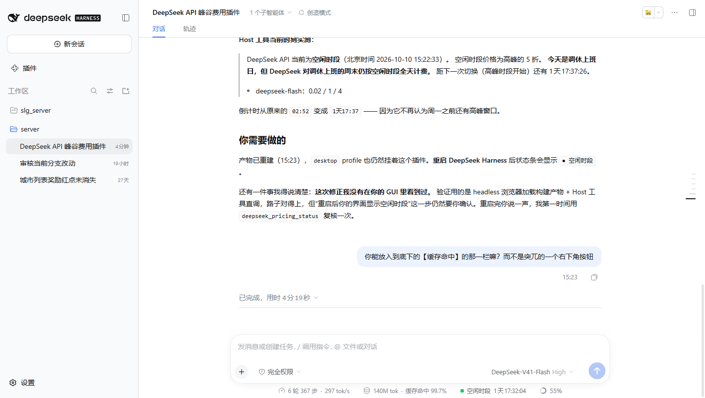

# dsh-deepseek-peak-pricing

DeepSeek Harness 插件：一眼看出当前的 API 请求走的是**高峰**还是**空闲（谷时）**计价。

六个面，数据同源：

| 面 | 位置 | 作用 |
|---|---|---|
| **状态条** | 输入框底下那一行的第三个读数 | 当前时段（**高峰黄灯 / 谷时绿灯**）+ 倒计时，点击展开价目表 |
| **展开面板** | 状态条上方 | 峰/谷两列单价、当天峰谷时长、未来 4 次切换时间线 |
| **切换提醒** | 右下角，12 秒后自动消失 | 进入谷时/高峰时提示，进入高峰前 5 分钟预告 |
| **`deepseek_pricing_status` 工具** | 模型侧 | 回答"现在什么价、下次什么时候变、跑这批要多少钱" |
| **`/pricing` 命令** | 输入框 `/` 菜单 | 人不经过模型直接看读数，可带时间参数 |
| **配置页** | 「插件」→ 本插件 → 行右侧「配置」 | 改日历、高峰时段与提醒开关，保存即生效（写入 profile 的 patch） |

规则来源有两处，缺一不可：

1. [DeepSeek API 模型 & 价格](https://api-docs.deepseek.com/zh-cn/quick_start/pricing/) —— 北京时间周一至周五（不含中国法定节假日）09:00-12:00、14:00-18:00 为高峰；其余时段，包括周末及中国法定节假日全天均为空闲。空闲时段价格为高峰的 **5 折**。
2. DeepSeek《API 峰谷时间说明》（2026-09-19）—— **调休上班的周末、中国法定节假日全天均按空闲时段计费**（[IT之家报道](https://tech.ifeng.com/c/8wYE8addLCR)）。价目页没写这一条，但它决定了一个反直觉的结果，见下文。

## 状态条长什么样

它在**输入框底下那一行**，跟 ui-chat 的用时/用量读数并排。这是 **2026-10-10 周六调休日** 的实际读数：



```
6 轮 367 步 · 297 tok/s   140M tok · 缓存命中 99.7%   ● 空闲时段 1天17:32:04   55%
└──── ui-chat 自带 ────┘  └──── ui-chat 自带 ────┘  └─ 本插件 ─┘          └ 上下文 ┘
```

点击后在其上方展开：

```
┌──────────────────────────────────────────────────────────────┐
│ ● 空闲时段                             10-10 15:27:55 北京     │
│ 距转入高峰（高峰时段开始）还有 1天17:32:04                     │
│ 今天：高峰 0 小时 · 谷时 24 小时                               │
│                                                              │
│ 元 / 百万 tokens      时段      缓存命中  未命中    输出       │
│ deepseek-flash        谷时 ★      0.02      1        4        │
│                       高峰        0.04      2        8        │
│ deepseek-v4-pro       谷时 ★      0.15     4.5      13.5      │
│                       高峰         0.3      9        27        │
│                                                              │
│ 接下来                                                        │
│ 10-12 09:00   高峰时段开始      3 小时                         │
│ 10-12 12:00   午间谷时开始      2 小时                         │
│ 10-12 14:00   高峰时段开始      4 小时                         │
│ 10-12 18:00   谷时开始         15 小时                         │
│                                                              │
│ 周末 · 全天谷时（今天调休上班，但 API 仍按周末计费）            │
│ 谷时为高峰价的 5 折，适合跑批量与长任务。                      │
│ 高峰：周一至周五 09:00-12:00、14:00-18:00（北京时间，不含中国   │
│ 法定节假日）；其余时段、周末与法定节假日全天均为谷时，调休上    │
│ 班的周末也按谷时。                                            │
│ 日历与时段来自 Host 的插件配置（改 profile 的 cordis.patch.yml  │
│ 即生效，两个半一起变）。                                       │
└──────────────────────────────────────────────────────────────┘
```

（`docs/dock-panel.png` 是本次改版**之前**的展开面板截图，保留作对照：价格表当时只有当前时段一列，也没有时间线。）

**★ 标在正在生效的那一列上**，两列都列出来，是为了让"要不要现在跑"变成一个减法而不是一次心算：谷时 1 元 / 高峰 2 元，差价直接写在相邻两行里。

（工作日高峰时段的读数：`● 高峰时段 02:52:16`，`★` 换到高峰那两行。）

### 切换提醒

状态条只在"你看着它"的时候有用；提醒是为了不用看着它。进入谷时会弹一条：

```
┌────────────────────────────────────────┐
│ 已进入谷时（高峰价的 5 折）          ×  │
│ 适合跑批量与长任务；单价已在下方的价目   │
│ 表里切换。                             │
└────────────────────────────────────────┘
```

- 只在**页面盯着的那段时间内真的发生切换**时弹：刚打开页面不会被追认一次"你错过了"。
- 12 秒后自动消失，也可以点 `×`；同一段时间只弹一次，不会每秒刷屏。
- 进入高峰**前 5 分钟**（`remindBeforePeakMinutes`）再预告一次，好让长任务在涨价前起跑。
- 两个行为都能在配置里关掉（`notifyOnSwitch: false` / `remindBeforePeakMinutes: 0`）。

### 为什么挂在这个 slot

`conversation.composer.dock` —— ui-chat 的 `StatsPills`（`stats.cacheHit`，就是那栏【缓存命中】）就注册在这里，`order: 0`。本插件注册 `order: 10`，于是它天然排在缓存命中右边，成为同一行的第三个读数。

样式也刻意复刻了 `StatsPills.module.css`：透明底、`1px 8px` 内边距、`999px` 圆角、tier 级文字色、hover 才出现一层淡背景。差别只有**那盏灯**：

| 时段 | 灯 | 取色 | 文字 |
|---|---|---|---|
| 高峰 | 琥珀黄灯 | `--dsw-alias-state-warn-primary`（主题里 = `#f59e0b`） | 一起变黄加粗 |
| 空闲 | 绿灯 | `--dsw-alias-state-success-primary`（主题里 = `#22c55e`） | 保持 tier 灰 |

灯是 8px 圆点 + 一圈同色光晕（`rgba(...,0.22)`），所以看起来是"亮着"而不是"印上去的"；两个色值都写成 `var(--token, #字面值)`，主题若少了这个别名，灯依然是黄/绿而不是透明。面板标题前和切换提醒上挂的是同一盏灯（`.dspp-lamp`），三处状态永远一致。

谷时的文字刻意**不**变绿：谷时是常态（约 2/3 的时间），而黄灯是异常，让异常自己跳出来，常态安静地待在和另外两个读数同一行。

**状态条没有做成浮在右下角的按钮**，因为那是"第二处要抬头看的地方"——同一类数字应该在同一行。**提醒相反，它是浮层**（`shell.overlay`）：它报的是一次事件，不是一处常驻读数，常驻下来就又变成第二个要抬头看的地方了。**配置页就更远**（`plugins.row.config`）：它是"一年改两次"的东西，放在插件页里，日常视野里一点也不占。

## 内置的日历

`2026年部分节假日安排`（国办发明电〔2025〕7号，2025-11-04 发布）：

| 节日 | 区间 | 节日 | 区间 |
|---|---|---|---|
| 元旦 | 01-01 ~ 01-03 | 端午节 | 06-19 ~ 06-21 |
| 春节 | 02-15 ~ 02-23 | 中秋节 | 09-25 ~ 09-27 |
| 清明节 | 04-04 ~ 04-06 | 国庆节 | 10-01 ~ 10-07 |
| 劳动节 | 05-01 ~ 05-05 | | |

**调休上班日（周末，仍按周末计费 = 全天谷时）**：`01-04`、`02-14`、`02-28`、`05-09`、`09-20`、`10-10`。

> ### ⚠️ 调休日是全天空闲，不是高峰
>
> DeepSeek 在 **2026-09-19** 的《API 峰谷时间说明》里明确：**"调休上班的周末、中国法定节假日全天均按空闲时段计费。"** 更早（2026-08-23）的调整也说明 **"周六、周日全天不再区分峰谷时段"**。
>
> 也就是说：**"是周末"这个属性本身就决定全天谷时，调休不改变它。**
>
> 这与直觉相反 —— `2026-10-10` 是国家规定的上班日，但 API 仍按谷时收费。本插件早期版本把调休日按工作日处理（判成高峰），**方向搞反了**，已于构建产物中修正；现在有回归测试锁住这条规则：
>
> ```
> a 调休上班日 Saturday still bills off-peak all day
> the makeup-workday list never changes a price
> a whole 调休 week bills like the calendar week it really is
> ```
>
> 判定优先级：**法定节假日 → 周末 →（两者都不是才是）工作日高峰窗口**。调休名单不再参与定价。

| 日期（2026） | 星期 | 判定 |
|---|---|---|
| 10-09 | 周五 | 工作日 → 高峰 09-12 / 14-18 |
| **10-10** | **周六（调休上班）** | **周末 → 全天谷时** |
| 10-11 | 周日 | 周末 → 全天谷时 |
| 10-12 | 周一 | 工作日 → 高峰 09-12 / 14-18 |

## 安装

`lib/` **已随仓库提交**（预构建产物），所以从 GitHub 装不需要跑 esbuild —— 这一点很关键：pnpm ≥10 默认拦截第三方构建脚本，源码安装会逼每个用户先做一次 `allowBuilds` 放行。

```bash
# 从 GitHub（推荐，免构建）
dsh plugin --profile desktop add github:<owner>/dsh-deepseek-peak-pricing

# 或从本地目录（开发时）
dsh plugin --profile desktop add /path/to/dsh-deepseek-peak-pricing
```

### 自己改代码时

```bash
node scripts/build.mjs   # 改完 src/ 必须重跑，并把 lib/ 一起提交
```

`lib/` 里的 `.js.map` 也一并提交：官方 UI 插件的构建契约要求产物带 sourcemap，市场里已有插件这么做。

装完**重启该 profile**（`dsh.profile.bundles` 变化属于启动期变更，热重载不覆盖）。重启后输入框底下那一行多出时段读数。

**只改了 `lib/client.js` 时不必重启**：浏览器半是每次页面加载时从磁盘取的，刷新页面即可。**Host 半（`lib/index.js`）的任何改动都要重启 profile** —— 工具、`/pricing` 命令、以及下面说的配置投影都在那一半。

`dsh plugin add` 会把包加进 `dsh.profile.bundles`，插件自带的 `cordis.patch.yml` 用 `insert` 把自己的 Host 行插进配置树；浏览器半由 `package.json` 的 `dsh.client` 声明被 Web boot 扫描发现，不需要额外配置行。

## 配置

两个入口，改的是同一份东西（Host 的 `Config`，最终落在 profile 的 `cordis.patch.yml`）：

**入口一：图形界面。** 「插件」页 → `dsh-deepseek-peak-pricing` → 那一行右侧的「配置」。可以增删法定节假日、调休日与高峰时段，切换提醒开关；保存前会用 Host 启动时同一套校验先拦一遍（比如 `start > end`、空节假日表、非法时段都会直接在页面上说明并禁用保存），所以存不进去一个 Host 会拒绝的日历。保存成功后工具、`/pricing`、状态条与提醒**同时**换日历，不用重启。

这一步走的是 Plugin Manager 的 `plugins.row.config` keyed slot（key 为 `<包名>#<行 id>`），写在 `PricingConfigPage` 里；写入经 `configForms` 的 `mutate`，也就是 profile patch 的正规通道。

**入口二：直接改 profile 的 patch。** 按 `id` 定位（**注意：patch 是整段替换 config，不是深合并，要重述所有仍然需要的键**）：

```yaml
- id: deepseek-peak-pricing
  config:
    holidays:
      - { start: "2026-01-01", end: "2026-01-03", name: "元旦" }
      # …新一年的安排发布后整份替换
    makeupWorkdays: ["2026-09-20", "2026-10-10"]
    peakWindows:
      - { startMinute: 540, endMinute: 720 }
      - { startMinute: 840, endMinute: 1080 }
    notifyOnSwitch: true
    remindBeforePeakMinutes: 5
```

| 字段 | 含义 |
|---|---|
| `holidays` | 法定节假日区间（含首尾，北京日期），当天全天谷时 |
| `makeupWorkdays` | 调休上班日。**仅用于说明，不影响计价** —— 调休的周末仍全天谷时 |
| `peakWindows` | 高峰时段，北京时间的当日分钟数，左闭右开 |
| `notifyOnSwitch` | 时段切换时是否弹提醒（浏览器半） |
| `remindBeforePeakMinutes` | 进入高峰前多少分钟预告；`0` 关闭（浏览器半） |

### 配置怎么走到浏览器半

这五项在 Host 的 `Config` schema 里都是 **`.volatile()` 且带内置默认值**，于是：

1. Host 半每次回答都重新读一遍配置引用（`resolveRules` → `.get()`），所以**图形界面里保存的那一下，工具与 `/pricing` 的下一个回答就是新日历**；
2. dsh-settings 的**配置投影**（`configForms`）把这份值同步给浏览器半，状态条、面板、提醒与配置页读的是**同一份日历**。

浏览器半用**可选的子注入**拿这份配置：

```ts
ctx.inject(['configForms'], (scope) => { watchSettings(scope.configForms.get('deepseek-peak-pricing')) })
```

拿不到就退回内置日历（非回环页面、或没有 settings 面的 profile），面板底部会写明当前用的是哪一份 —— 三种情况（Host 配置、内置日历、配置有问题已回退）都写清楚，不会让人对着一个说不清来源的价格表猜。

> 这正是本插件上一版最大的隐患：Host 与浏览器半各有一份手抄的日历，`README` 只能靠一条测试（"两半日历一致"）勉强拴住。现在规则只有一份（`src/shared/pricing.ts`，构建时内联进两个产物），配置则通过 `configForms` 单向流动。

## 开发

```bash
node scripts/build.mjs    # 产出 lib/index.js / lib/client.js / lib/shared/pricing.js
node --test tests/pricing.test.mjs tests/client.test.mjs tests/host.test.mjs
# 或 npm test
```

产物三份，都被 DSH 直接按路径读取：

| 产物 | 形态 | 消费者 |
|---|---|---|
| `lib/index.js` | ESM，具名导出 `name/inject/Config/apply` | Host Loader（Cordis 函数插件） |
| `lib/client.js` | `window.__ModuleLoader__.load({ id, factory })` 闭包 | Web shell 的模块表 |
| `lib/shared/pricing.js` | ESM 纯规则核心 | 三份测试 |

`@deepseek-ai/*` 在 Host 半保持 external，运行时从 profile 安装里解析；浏览器半只把 `react`、`react/jsx-runtime` 交给 shell 模块表（它们是平台种子模块），其余全部内联 —— `src/shared/pricing.ts` 也是这样被内联进来的，所以浏览器半没有 intra-package 运行时 import。构建脚本里的 `PLATFORM_MODULES` 同时是浏览器半的纯度门：出现表外 bare import 直接报错，而不是等运行时 throw。

### 测试里最值钱的那条

`tests/host.test.mjs` 会**同时加载两个构建产物**（`lib/index.js` 走真实 ESM import，`lib/client.js` 走 module-loader 桩），对同一时刻问同一个问题，然后逐字段比对：

```js
const value = await tool.execute({ at: '2026-10-12 10:30' })
const reading = client.read(bj('2026-10-12T10:30:00'))
assert.equal(value.period, reading.period)
assert.equal(value.countdown, client.formatCountdown(reading.remaining))
assert.deepEqual(value.dayLoad, reading.load)
```

三份手抄的日历可以悄悄漂移；一个共享的内核 + 一条逐字段比对的测试不能。

### 一个必须记住的契约

客户端插件**必须**声明依赖，Cordis 会拒绝任何未声明的 `ctx.<service>` 读取：

```ts
export const inject = ['slots']
```

漏掉它的表现是 shell 顶部一条 `Failed to load plugins`，而报错只说 `dsh-deepseek-peak-pricing: failed` —— 真正的错误（`cannot get property "slots" without inject`）被 boot 摘要吞掉了。要拿到原文，用 CDP 打开页面并在 `apply` 外层临时包一层 try/catch。

`configForms` 则**故意不写进 `inject`**：它是"有就用、没有就算"的能力，写进去会让没有设置面的 profile 直接不加载这个插件。

### 三个 slot，三种挂法

| slot | kind | 挂法 |
|---|---|---|
| `conversation.composer.dock` | list | `id: 'deepseek-peak-pricing'`，和 ui-chat 的用量读数并排 |
| `shell.overlay` | list | `id: 'deepseek-peak-pricing-notice'`，浮层提醒 |
| `plugins.row.config` | keyed | `key: 'dsh-deepseek-peak-pricing#deepseek-peak-pricing'`，即 `<包名>#<行 id>` |

keyed slot 只认 `key`、list slot 只认 `id`，写错会在注册时抛（"keyed slot requires options.key"）；`key` 写错不会抛，只是那一页永远不出现 —— 所以 `apply()` 的注册测试把这三个 key 都钉住了。

### 一条更贵的教训：别把公告之外的规则"推理"出来

这个插件第一版把调休上班日按**工作日**处理，理由是"调休日不是法定节假日，所以不该算谷时"。听起来合理，但**与官方口径相反**：DeepSeek 明确按周末对待调休日。

价目页只写了"周一至周五（不含中国法定节假日）"，**没有**提调休。当时的我拿这条不完整的表述去推理剩下的情形，而不是去找有没有专门的说明 —— 结果一个方向性错误，把国家规定的上班日算成了高峰价。

可复用的做法：**规则表里的每一条边界情形（调休、闰日、时区例外），要么有官方原文，要么标为"未知/待确认"，不要用相邻条款推出来。** 现在这个仓库把两处依据都写进了源码头注释，并留了回归测试：

```
a 调休上班日 Saturday still bills off-peak all day
the makeup-workday list never changes a price
a whole 调休 week bills like the calendar week it really is
```

## 模型侧能问什么

`deepseek_pricing_status` 无参数即可回答"现在"，也可以带参数：

| 参数 | 作用 |
|---|---|
| `at` | 要看哪个时刻：`2026-10-12`、`2026-10-12 10:00`、`10:00`（今天），或带时区的 ISO 8601 |
| `switches` | 时间线要列几段（1-8，默认 3） |
| `model` + `tokens` | 给一批 token 算钱，并同时给出**另一个时段的价钱**，用于"现在跑还是等谷时" |

返回里带 `period`、`countdown`、`nextReason`、`dayLoad`、`switches`、`prices`、`estimate` 与完整的规则原文，所以模型的回答是自洽的、不需要再查文档。同样的文本就是 `/pricing` 命令的输出：

```
/pricing 2026-10-12 10:30
```

估错时间（`/pricing 昨天下午`）会得到一个说明可用格式的错误，而不是一个猜测的价格。
